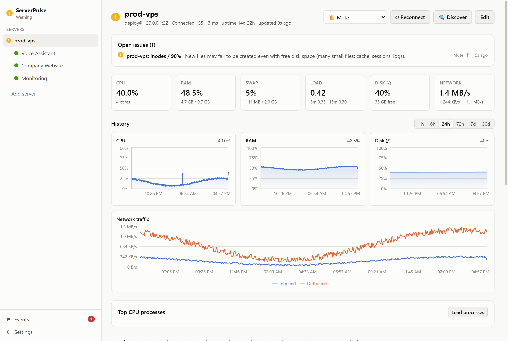
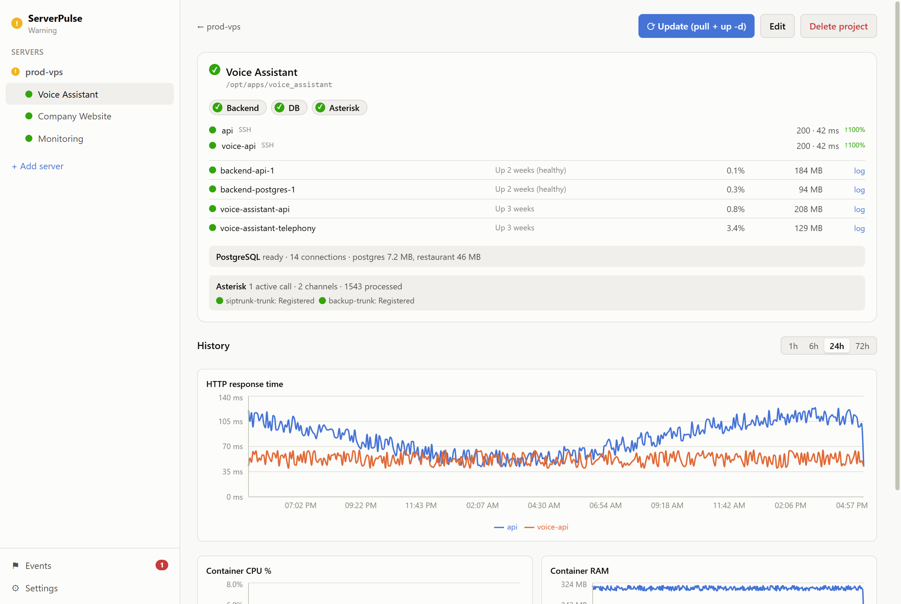
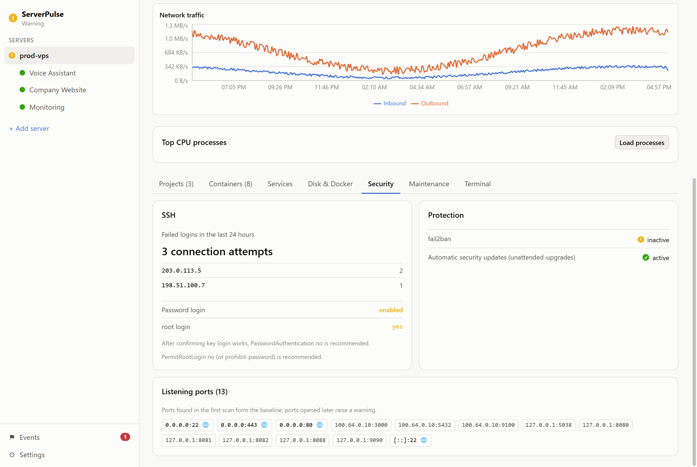
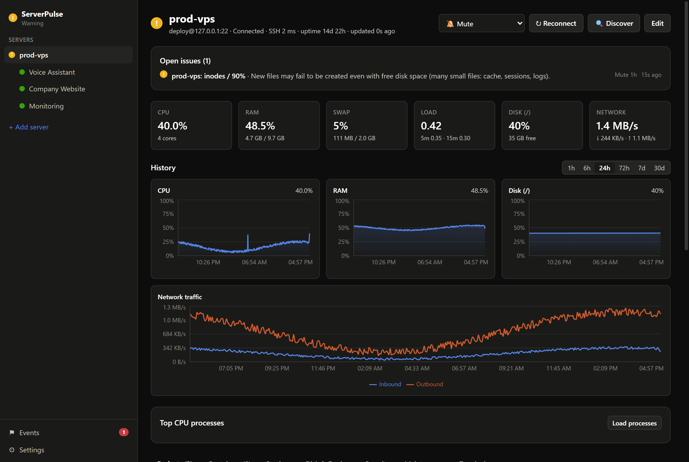
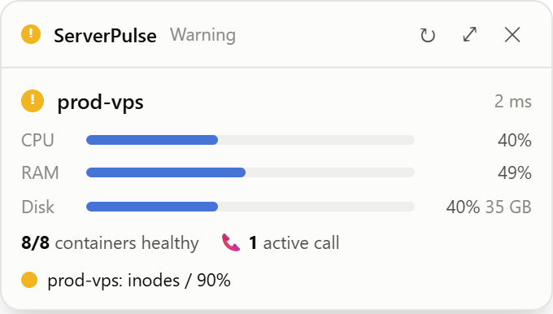

# ServerPulse

**English** · [Türkçe](README.tr.md)

A desktop app that monitors your servers and the projects running on them (Docker, systemd, .NET/TS backends, PostgreSQL, Asterisk) from your own computer, without logging into the VPS. Runs on Windows (x64) and macOS (Apple Silicon). Open source under the [MIT license](LICENSE).



**Agentless:** nothing is installed on the server. The app connects over SSH, runs a fixed set of read-only commands and parses the output on your computer. No long-running process is left on the server; logs are only read with `--tail 200` / `-n 200`, never followed with `-f`.

- **Widget (bottom right):** status, CPU/RAM/disk bars, "8/8 containers healthy", active calls and open issues for each server. Red states are shown first. Click to open the dashboard.
- **Tray / menu bar:** the icon color follows the worst state (green, yellow, red, grey). Click to toggle the widget; the context menu has Dashboard, Refresh and Quit.
- **Dashboard:** server/project tree, project cards (Backend/Frontend/DB/Asterisk badges, HTTP response time and uptime %, days until SSL expiry, container CPU/RAM), CPU/RAM/disk and network charts from 1 hour to 30 days (local SQLite; Prometheus optional), process list, security tab, logs, `docker system df`, event history.
- **Alerts:** native notifications on state changes (debounced). Optionally also sent to **Telegram** and a **webhook** (Settings → External notifications; tokens/URLs are encrypted in the OS secure storage).
- **Language:** English and Turkish (Settings → General → Language). The default "System" picks Turkish on a Turkish OS and English otherwise. Strings live in `src/shared/i18n/`; a new string goes into `tr.ts` first and into `en.ts` under the same key (a missing key is a compile error).

| Project view | Security tab |
|---|---|
|  |  |
| **Dark theme** | **Widget** |
|  |  |

## Download

The Windows installer (x64) is on the [Releases](https://github.com/tanjavaner/serverpulse/releases/latest) page. Installed copies download new versions by themselves (Settings → Updates). For now the macOS package is built on a Mac with `npm run dist:mac` (see below).

## Development

```bash
npm install
npm run dev          # electron-vite, hot reload
npm test             # vitest: parser, discovery, alert tests
npm run typecheck
```

> If the Electron binary was not downloaded after `npm install`: `node node_modules/electron/install.js`

## Packaging

```bash
npm run icons        # regenerates build/icon.png (optional; the file is in the repo)
npm run dist:win     # on a Windows PC → dist/ServerPulse-Setup-x.y.z.exe (NSIS, x64)
npm run dist:mac     # on a Mac        → dist/ServerPulse-x.y.z-arm64.dmg
```

There are no native dependencies: SQLite comes from Electron's built-in `node:sqlite`, so `electron-rebuild` and build tools are not needed. Each platform's package should still be built on that platform.

- **macOS:** the package is unsigned, so open the dmg the first time with right-click → **Open**, or run `xattr -dr com.apple.quarantine /Applications/ServerPulse.app`. Signing and notarization need an Apple Developer account (optional). The app runs as a menu bar app (`LSUIElement`); the Dock icon only appears while the dashboard is open.
- **Windows:** the unsigned `.exe` may trigger a SmartScreen warning: "More info" → "Run anyway".
- **Start at login:** Settings → "Start at login". Only takes effect in the installed version.

## Server preparation (one-time, recommended)

The app also works as root, but a separate user is recommended for read-only monitoring. The easiest way: **Add server → "Prepare the server (optional)"** generates a single script block for the user name in the form. Connect to the server as root or a sudo user and paste it. The script can be run again safely and it:

- creates the user if missing and, as selected, adds it to the `docker` (read containers) and `systemd-journal` (service logs and failed SSH logins on the security tab) groups;
- adds the public line of the selected private key (the app derives it from the key) to `authorized_keys` once;
- writes `/etc/sudoers.d/serverpulse` only for the selected jobs and does not enable it unless `visudo -cf` validates it:
  - Maintenance: `NOPASSWD:SETENV: /usr/bin/apt-get, /usr/bin/systemctl reboot` (the app uses `sudo VAR=… apt-get`; since it does not need `sudo env …`, there is no need to allow `env`, i.e. every command)
  - Asterisk: three read-only `asterisk -rx` commands

To do it by hand:

```bash
sudo usermod -aG docker deploy
sudo usermod -aG systemd-journal deploy
ssh-keygen -t ed25519 -f ~/.ssh/serverpulse -C serverpulse   # on your PC
ssh-copy-id -i ~/.ssh/serverpulse.pub deploy@server.example.com
```

> Note: membership in the `docker` group and sudo for `apt-get` are effectively root. The app only runs whitelisted commands, but protect the key accordingly and grant only the permissions you will use.

Without the Asterisk rule, only the result of `systemctl is-active asterisk` is shown. "Test connection" and the maintenance status check verify permissions with `sudo -n -l` (lists without running); maintenance buttons without permission are disabled.

### Sign-in methods

- **Private key** (recommended): the key is stored encrypted in the OS secure storage.
- **SSH agent:** the key is never copied into the app. On Windows, the OpenSSH agent (the 1Password/Bitwarden agents use the same pipe) or Pageant; on macOS, `SSH_AUTH_SOCK`.
- **Password:** supported but not recommended.

When adding a server, the Host blocks of your `~/.ssh/config` can be picked from the list at the top right of the form to fill in host, port, user and key file (the host key is still confirmed).

### Moving to a new computer

**Settings → Move your configuration:** servers, projects and settings are exported to a JSON file; host key confirmations are kept and existing servers are skipped on import. If "Include passwords, keys and notification tokens" is checked, they are encrypted with a password (scrypt + AES-256-GCM); otherwise you enter credentials for imported servers via Edit.

### Security advice (outside the app's scope)

Many VPS images ship with `PasswordAuthentication yes` and `PermitRootLogin yes`. Once the app works with a key (ideally over a private network such as a VPN/Tailscale address), consider turning both off in `/etc/ssh/sshd_config`. Before that, confirm key login works in a separate session.

## Usage

1. **Add server:** name, host/IP, port, user and sign-in method (private key, SSH agent or password). If the server is not prepared yet, use the "Prepare the server" script.
2. **Test connection:** the host key fingerprint is shown first. Compare it with `ssh-keygen -lf /etc/ssh/ssh_host_ed25519_key.pub` on the server and confirm (TOFU). Then `uname -a`, `id`, docker access and the Asterisk sudo rule are checked.
3. **Save and discover:** `docker ps` (compose labels), running systemd services, `ss -tln` and `/etc/nginx/sites-enabled/*` are read. A compose `working_dir` is proposed as a project, and nginx `server_name` → `proxy_pass` port as its public URL. Accept or edit the proposals. Projects under the same parent directory (e.g. `/opt/apps/x/backend` and `/opt/apps/x/socket`) get a "Merge" suggestion; you can also select proposals and merge them into one project yourself. "Delete all and rediscover" on the server view deletes the saved projects and starts discovery again.
4. On a project, use **Edit** to set health paths, container roles, the Postgres user and so on.

### Server maintenance (Maintenance tab)

The status check (kernel, reboot required, pending/security updates, containers with restart policy `no`) always works. Other operations require **Settings → Management actions** and a native confirmation; sudo must work without a password (`sudo -n`). Package upgrade and autoremove are only supported on **Debian/Ubuntu (apt)**; on other distributions the status check says so and the related buttons are disabled.

- **Postgres backup:** `pg_dumpall | gzip` (`pipefail`), verified with `gunzip -t` + "dump complete" + sha256, downloaded over SFTP into `backups/<server-id>/`; the last 7 backups are kept on the server. The container/user comes from the server settings or is detected automatically.
- **Upgrade:** `apt-get update && upgrade` runs on the server independently of the session (`~/serverpulse-maint/upgrade-*.log`) and the output streams live. If there is no backup from the last 24 hours, a backup is suggested first.
- **Reboot:** type `REBOOT` + native confirmation, wait until the server is back (max 5 min) and an automatic post-reboot check (new kernel, containers Up/healthy). During reboot/upgrade, reachability alerts are silenced for at most 10 min.
- **Restore** (Advanced): type `RESTORE` + native confirmation. A pg_dumpall backup does not drop existing databases; restoring into an empty/new container is safest. Because psql also exits successfully on SQL errors, errors in the output are counted: expected "already exists" warnings are ignored, and other errors (e.g. `duplicate key`) mark the operation as failed. `do-release-upgrade` is out of scope.

Each step is written to `maintenance.log` (JSONL).

### One-click management (Settings → Management actions)

Every operation asks for a native confirmation and only works on discovered/monitored containers.

- **Start / stop / restart container:** on the Containers tab, depending on the container state.
- **Update project:** the "⟳ Update (pull + up -d)" button on a project runs `docker compose pull && up -d` with the compose project, directory and files read from the project's container labels. Like the upgrade, it runs on the server independently of the session (`~/serverpulse-maint/deploy-*.log`), the output streams live, and container alerts are silenced for at most 10 min. Requires the Compose v2 plugin; the project's containers must belong to a single compose project.
- **Disk cleanup (Disk & Docker tab):** "Safe cleanup" removes dangling images and the build cache; "Delete all unused images" removes images no container uses. Volumes and containers are never touched.
- **Logs:** last 200 / 1000 / 5000 lines, optional time range (15 min, 1 h, 24 h), filter, save to file and auto-refresh every 5 s. Auto-refresh stops by itself after 10 min and re-reads each time; no follow (`-f`) process is left on the server.

### Terminal (Settings → Allow terminal)

Off by default and separate from management actions. When on, the server view gets a **Terminal** tab: xterm.js over a separate SSH session, independent of the monitoring connection (the host key is still verified); the session closes when you leave the tab or close the window. Commands typed in the terminal run directly on the server; the app's command whitelist and confirmation dialogs do not apply there.

If the host key changes later, the connection is stopped and a red "host key changed" alert is raised. If the server was reinstalled, confirm the new fingerprint from the Edit screen.

### Visibility (read-only)

- **Network traffic:** inbound/outbound bytes/s from the difference of `/proc/net/dev` counters. Loopback, Docker (`docker*`, `veth*`, `br-*`) and VPN (`tailscale*`, `wg*`, `tun*`) interfaces are not counted; VPN traffic already shows up on the physical interface, so it is not counted twice.
- **History and uptime:** charts up to 72 hours are drawn from raw samples (every 30 s), 7 and 30 days from 5-minute rollups. Raw data is rolled up before it is deleted; rollups are kept for 30 days. The HTTP check badge on a project card shows the success rate of the last 24 hours, and 7 and 30 days on hover (below 99.9% yellow, below 99% red). Prometheus remains an optional alternative.
- **Processes:** a card on the server view reads the top 15 processes by CPU (`ps`) on demand; it does not run periodically.
- **Disk details (Disk & Docker tab):** inode usage (the disk threshold also raises inode alerts) and containers without log rotation. With the `json-file` driver and no `max-size`, the log file grows without limit; the app shows a `daemon.json` example.
- **Security tab** (every 5 min):
  - failed SSH logins in the last 24 hours and the top 5 source IPs. Needs the `systemd-journal` group; if the journal cannot be read, a warning is shown instead of "0 attempts";
  - `PasswordAuthentication` / `PermitRootLogin` values (`sshd -T` as root, otherwise the config files) and recommendations;
  - fail2ban and unattended-upgrades status;
  - listening TCP ports. Ports found in the first scan form the baseline; every port opened later raises a warning (listeners on `0.0.0.0`, `::` or `*` are flagged as public). If the change is expected, "Accept current ports as baseline" closes the alert.
- **Light mode (Settings):** the most expensive command, `docker stats`, runs every 30 s instead of every 5 s; the latest CPU/RAM values are shown in between. Meant for 1 vCPU servers.

## Architecture

```
Electron main process
 ├─ ssh/connection.ts     One persistent ssh2 connection per server, keepalive, 2→60 s exponential reconnect,
 │                        TOFU host key verification, at most 4 concurrent channels
 ├─ ssh/commands.ts       Whitelist of ALL server commands + input validation (^[a-zA-Z0-9_.-]+$)
 ├─ collectors/           reach, host, docker, dockerMeta, systemd, httpLocal, httpPublic, ssl, postgres, asterisk,
 │                        storage, security
 ├─ parsers/              Pure parse functions (fixture-tested); broken output → null/"unknown", never throws
 ├─ scheduler.ts          5 s / 30 s / 5 min / 6 h tiers; the same collector never overlaps itself
 ├─ store/                config.json, secrets.json (safeStorage), history.sqlite (node:sqlite; 72 h raw, 30 d rollups)
 ├─ alerts/               evaluate (state → issues, pure) + AlertEngine (debounce, flapping protection)
 ├─ discovery/            Project proposals from discovery output (pure, tested)
 └─ ipc.ts                Typed IPC (src/shared/ipc.ts), only from the app's own windows
Renderer (React + Tailwind + Recharts), contextIsolation + sandbox, nodeIntegration off
 ├─ widget/               Frameless, bottom right, height follows content
 └─ dashboard/            Servers → projects → details, charts, logs, settings, events
```

Each collector runs several commands in a single SSH `exec`, separated by `@@S <section>` / `@@RC <code>` markers. So each round opens a few short-lived channels on the server, all closed when the command ends.

| Collector | Interval | From | What |
|---|---|---|---|
| reach | 30 s | PC → TCP 22 + SSH `true` | Reachability, latency |
| host | 5 s | SSH: `/proc/*`, `nproc`, `df` | CPU % (difference of two /proc/stat reads), RAM, swap, load, uptime, disk, network RX/TX |
| docker | 5 s | SSH: `docker ps/stats/inspect` | State, health, restart count, CPU/RAM, compose project (`stats` every 30 s in light mode) |
| dockerMeta | 5 min | SSH: `docker system df` | Image/volume/cache sizes |
| systemd | 30 s | SSH: `systemctl is-active`, `--failed` | Service states |
| httpPublic | 30 s | PC → HTTPS | Status code, response time |
| httpLocal | 30 s | SSH: `curl 127.0.0.1:<port>` | Internal health endpoints |
| ssl | 6 h | PC → TLS handshake | Days until the certificate expires |
| postgres | 30 s | SSH: `docker exec pg_isready/psql` | Ready, connection count, DB sizes |
| asterisk | 30 s | SSH: `sudo -n asterisk -rx …` | Active calls, trunk registration, endpoints |
| storage | 5 min | SSH: `df -i`, `docker inspect` | Inode usage, containers without log rotation |
| security | 5 min | SSH: `journalctl`, sshd config, `systemctl is-active`, `ss -tln` | Failed SSH logins, sshd settings, fail2ban/unattended-upgrades, listening ports |
| prometheus | optional | SSH `forwardOut` → 127.0.0.1:9090 | 24 h / 7 d / 30 d charts (alternative to local history) |

### Alerts (defaults can be changed in Settings)

Server unreachable (2 consecutive attempts) · SSH authentication failed · container not running/unhealthy/missing · restart count increased · HTTP 5xx/timeout (2 consecutive checks) · `pg_isready` failed (2 consecutive checks) · Asterisk trunk not registered · disk or inodes > 85% (95% critical) · RAM > 90% (for 5 min) · SSL < 14 days (critical below 3) · monitored systemd unit not active · new listening port not in the baseline · host key changed.

An issue opens and notifies once it has lasted **10 s without interruption**, and closes once it has been absent for the same time. HTTP and PostgreSQL checks, which run every 30 s, also wait for a **consecutive failure threshold** (default 2), so a one-off glitch does not notify.

- **Authentication failure:** if the server rejects the password/key, the connection is not retried automatically (otherwise fail2ban could ban this computer's IP). Update the credentials or use "Retry" on the server view.
- **Containers not assigned to a project:** if no project is defined, all containers are monitored; one-off containers that never started (`Created`) or exited normally (`Exited (0)`) do not raise alerts.
- **Sleep/wake:** when the computer wakes up, connections are re-established immediately and alerts are not evaluated for 90 s so the network can recover.
- **No internet connection:** if all servers become unreachable over TCP at once, the app checks this computer's internet by connecting to public addresses (1.1.1.1, 8.8.8.8, 9.9.9.9). If the outage is on this side, a single "No internet connection" warning replaces the server alerts; open server alerts are frozen (not mistakenly counted as resolved). This warning is not sent to Telegram/webhook.
- **Mute:** "🔕 Mute" on the server view (1 hour, 4 hours, until tomorrow 09:00) stops notifications for that server, "Mute 1h" on an issue row only for that issue. Issues stay visible in the list and the event history; a mute lasts at most 30 days.
- **HTTP expectations:** in the project editor, each HTTP check can define accepted status codes (`200`, `200-299`, `200-399,401`), a text to look for in the response and a "slow" threshold (ms). For local (SSH) checks the text is searched on the server with `grep -F`; the response body never leaves the server. A warning is raised when the threshold is exceeded repeatedly.

### Telegram commands and daily summary

With Settings → External notifications → Telegram enabled:

- **Commands:** `/status` (`/durum`) sends a one-line summary per server, `/issues` (`/sorunlar`) the open issues. The bot only answers the registered chat ID, is read-only and works while the app is running (no webhook; long polling with `getUpdates`).
- **Daily summary:** the same summary is sent at the chosen time. If the app is closed or the computer is asleep at that time, it is sent when the app starts within 2 hours.

## Where is the data?

`%APPDATA%\ServerPulse` (Windows) · `~/Library/Application Support/ServerPulse` (macOS)

- `config.json`: servers (without secrets), projects, settings
- `secrets.json`: passwords/keys, encrypted with **safeStorage** (Windows DPAPI, macOS Keychain). Plain text is never written.
- `history.sqlite`: metric samples (every 30 s, 72 h), 5-minute rollups (30 days) and alert events (30 days)

## Tests and fixtures

The outputs under `tests/fixtures/` are an anonymized sample VPS inventory in real command formats (domains use `example.com`). `tests/discovery.test.ts` verifies that discovery finds 4 projects, 8 containers and 3 domains in it (acceptance reference). Tests never load the real `electron` package; `vitest.config.ts` points it to `tests/stubs/electron.ts`.

To work with real output, run `scripts/capture-fixtures.sh` on the server (read-only; usage is at the top of the script) and copy the collected files into `tests/fixtures/`. Some tests check specific values in the fixtures (e.g. a "Rejected" trunk); update those expectations when you switch to real output.

## Design notes

- **`node:sqlite` for SQLite:** instead of a native module such as better-sqlite3, the app uses `node:sqlite`, built into Electron 44 (Node 24). With no native build, packaging for Windows and macOS is simpler.
- **Container restart count** is read by the 5-second docker collector (a single `docker inspect --format` line) rather than the 5-minute `dockerMeta`, so the "restart count increased" alert is not delayed by 5 minutes.
- **Management actions** (start/stop/restart containers, update projects, Docker cleanup, server maintenance) are off by default. They can be enabled in Settings and always ask for a native confirmation in the main process.

## Contributing

Bug reports and pull requests are welcome. Run `npm run typecheck` and `npm test` before sending one. New server commands go only into `src/main/ssh/commands.ts` with validated inputs; output parsing is written as pure functions under `src/main/parsers/` with fixture tests. Every user-facing string must exist in both languages (`src/shared/i18n/`).

## Security

See [SECURITY.md](SECURITY.md) to report a vulnerability; please do not open a public issue.

## License

[MIT](LICENSE) © 2026 Yüksel Yazılım
